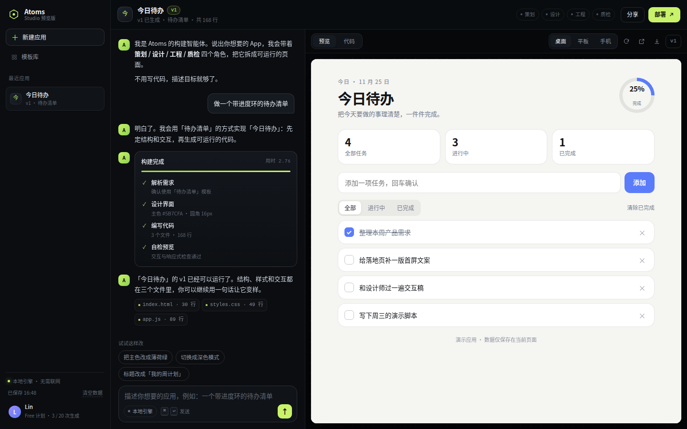

# Atoms Demo · 智能体应用生成工作台

一个单文件、可直接运行的 Atoms 风格 Demo：用一句话描述应用，智能体完成需求解析、界面设计、代码生成与实时预览。生成结果是真实可交互的网页，并支持项目与业务数据的本地持久化。



## 在线体验

部署地址：<!-- 部署后替换为 https://... -->

打开即用，无需注册，无后端依赖。建议使用最新版 Chrome / Edge。

## 功能

- **六类可运行应用**：待办清单、数据看板、番茄专注、记账本、产品落地页、收集表单
- **智能体流程**：四角色状态、流式思考、四步构建、耗时统计
- **一句话改版**：换主色、深浅色、改标题、圆角/留白、切换模板
- **版本管理**：每次生成追加 vN，可回看任意版本
- **预览/代码双视图**：文件树、行号、语法高亮、复制
- **画布设备**：桌面 / 平板 / 手机；刷新、新窗口打开、导出 HTML
- **数据持久化**：工作台的项目、版本、对话保存在 localStorage；生成应用用独立命名空间保存业务数据，刷新不丢
- **可选真实模型**：配置任意 OpenAI 兼容接口后，由模型生成单文件应用；未配置时使用内置本地引擎，完全离线
- **响应式**：窄屏单栏 + 底部对话/预览切换

## 本地运行

直接双击 `index.html`，或在目录内启动静态服务：

```bash
python3 -m http.server 8080
# 打开 http://localhost:8080
```

无需安装依赖，无需构建。

## 生成引擎

### 本地引擎（默认）

规则化意图识别 + 模板合成，覆盖六类常见应用，离线可用。

### 模型引擎（可选）

1. 打开页面左下角的「本地引擎」。
2. 填写 OpenAI 兼容的 Base URL、模型名、API Key，保存。
3. 之后的生成与修改会请求该接口，返回的单文件 HTML 会直接进入预览。

- 请求由浏览器直连你填写的地址，可能受对方 CORS 策略限制。
- 密钥只保存在当前浏览器的 localStorage，不会上传到任何中转服务。
- 接口需返回 `choices[0].message.content`，内容为完整的 HTML 代码块。

## 数据与隐私

- 项目与版本：`atoms-studio-v1`
- 模型配置：`atoms-engine-v1`
- 生成应用数据：`atoms:<项目ID>:<键名>`

所有数据仅存在当前浏览器；换设备或换域名不会自动同步。删除项目或清空数据会同步清理对应应用数据。

## 部署

纯静态，任选其一：

- **Netlify Drop**：把 `atoms-demo` 目录拖到 https://app.netlify.com/drop ，立即得到公网地址。
- **Vercel**：`npx vercel --prod`
- **GitHub Pages**：仓库 Settings → Pages → 选择 `main` 分支根目录。

> `index.html` 必须位于站点根目录，否则会 404。

## 目录

```
index.html                完整的单文件 Demo
README.md                 本文件
docs/Atoms-Demo-说明.md    设计说明、取舍与完成度
assets/preview.png        工作台截图
assets/gallery.png        模板库截图
```

## 已知限制

- 本地引擎是模板化生成，覆盖六类常见应用；超出类型会落到最接近的模板。
- iframe 为让生成应用使用 localStorage 启用了同源沙箱；生产化建议改为独立域 + postMessage 代理。
- 部署/分享弹窗内为示例地址，真实上线请按上文部署。